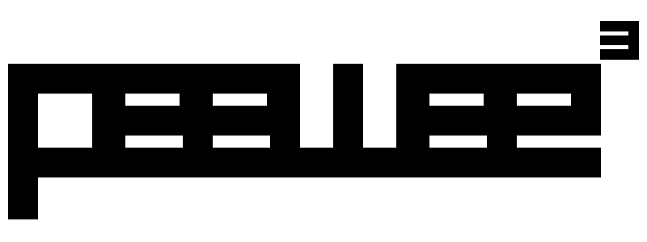

.. peers documentation master file, created by
   sphinx-quickstart on Thu Nov 25 21:20:29 2010.
   You can adapt this file completely to your liking, but it should at least
   contain the root `toctree` directive.

peers
======

Peers is a simple and small ORM. It has few (but expressive) concepts, making
it easy to learn and intuitive to use.

* a small, expressive ORM
* python 2.7+ and 3.4+
* supports sqlite, mysql, mariadb, postgresql.
* asyncio support
* :ref:`tons of extensions <playhouse>`

Peers's source code hosted on `GitHub <https://github.com/Star-DreamDev/peers>`_.

New to peers? These may help:

* :ref:`Quickstart <quickstart>`
* :ref:`Example twitter app <example-app>`
* :ref:`Using peers interactively <interactive>`
* :ref:`Models and fields <models>`
* :ref:`Querying <querying>`
* :ref:`Relationships and joins <relationships>`

Contents:
---------

.. toctree::
   :maxdepth: 2
   :glob:

   peers/installation
   peers/quickstart
   peers/example
   peers/interactive
   peers/contributing
   peers/database
   peers/models
   peers/querying
   peers/query_operators
   peers/relationships
   peers/api
   peers/sqlite_ext
   peers/cysqlite_ext
   peers/asyncio
   peers/playhouse
   peers/query_examples
   peers/query_builder
   peers/hacks
   peers/changes

Note
----

If you find any bugs, odd behavior, or have an idea for a new feature please don't hesitate to `open an issue <https://github.com/Star-DreamDev/peers/issues?state=open>`_ on GitHub or `contact me <https://charlesleifer.com/contact/>`_.

Indices and tables
==================

* :ref:`genindex`
* :ref:`modindex`
* :ref:`search`
